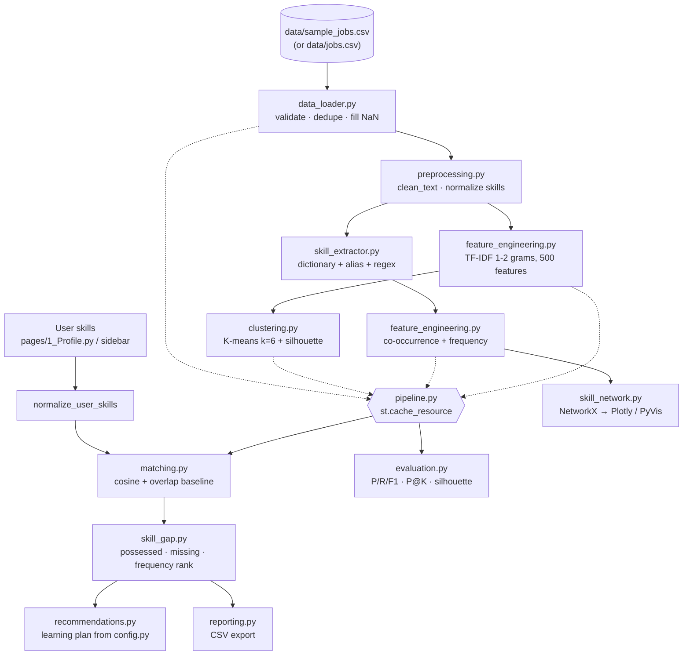

# SkillBridge — Architecture

## Data flow

## Layers (match PRD §9)

1. **Data input** — CSV dataset; user skills in `st.session_state.user_skills`.
2. **Processing** — `data_loader`, `preprocessing`, `skill_extractor`.
3. **Features** — TF-IDF matrix, co-occurrence counts (`feature_engineering`).
4. **ML / similarity** — K-means (`clustering`), cosine and overlap (`matching`).
5. **Recommendation** — `skill_gap`, `recommendations`.
6. **Presentation** — `app.py`, `pages/`, `reporting`.

## Key design decisions

- **`src/pipeline.py` holds the cached pipeline.** Pages previously imported it from `app.py`, which re-ran the whole dashboard script and crashed them. The models are fitted once per server process and reused across pages.
- **Schema contract:** every module relies on `job_id, category, job_title, job_description, job_skill_set` (`config.REQUIRED_COLUMNS`) plus derived `clean_description`, `extracted_skills`, `cluster`.
- **Canonical skill names** are lowercase; `aws` is canonical for AWS (alias `amazon web services → aws`).
- **Rule-based vs ML** is kept explicit: only K-means is trained; TF-IDF and cosine are feature/similarity tools; extraction and gap ranking are rules/statistics.
